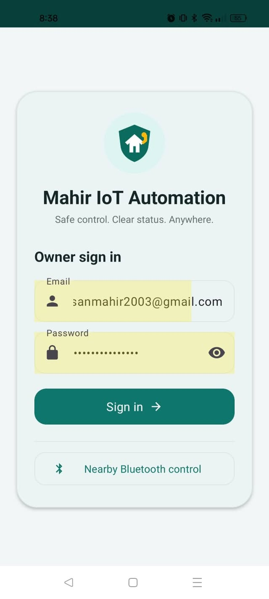
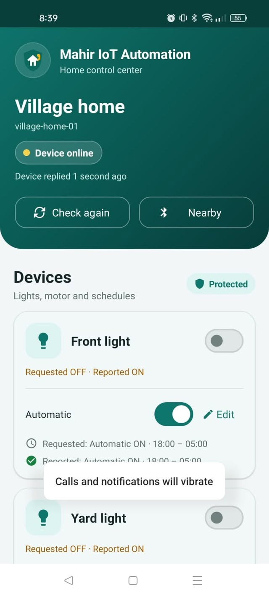
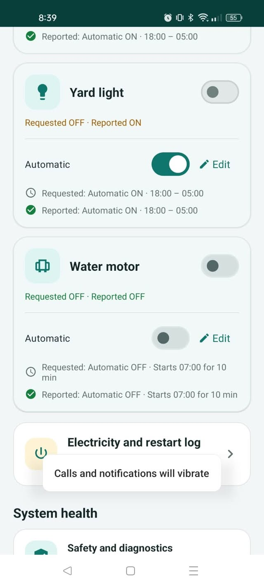
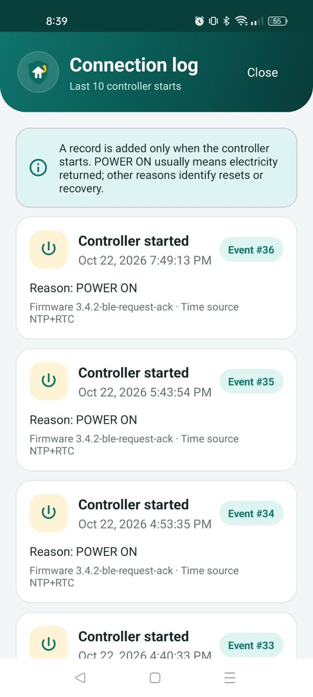

## 📱 Mobile Application Overview

The native Android companion app (Kotlin) provides two-way control, real-time telemetry, and offline diagnostics.

| 1. Dual-Channel Access | 2. Live Dashboard |
| :---: | :---: |
|  |  |
| **Secure Cloud & Offline BLE** Firebase Auth for remote control and an authenticated direct BLE fallback when internet is down. | **Real-Time Telemetry** Live connection status badge with 1-second heartbeat response tracking and one-tap refresh. |

| 3. Device & Schedule Control | 4. Power & Outage Logs |
| :---: | :---: |
|  |  |
| **Requested vs. Reported State** Independent schedules for lighting and protected water motor with safety cut-offs and cooldown timers. | **Diagnostics & Power Audit** Tracks power grid cuts, controller boot reasons, RTC sync sources, and firmware health history. |
)
